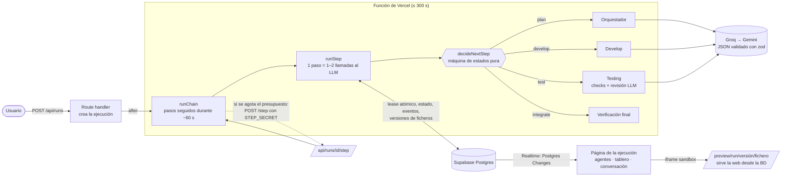

# Equipo de agentes: Orquestador · Develop · Testing

Tres agentes de IA trabajan juntos sobre la web de una panadería ficticia. Le pides un cambio, por ejemplo «añade una página de contacto a esta web»:

1. **Orquestador** analiza la petición y la web actual, la divide en tareas con criterios de aceptación verificables y se las reparte.
2. **Develop** implementa cada tarea y entrega ficheros HTML/CSS completos. Cada entrega es una **versión nueva** de la web.
3. **Testing** comprueba cada entrega con **pruebas deterministas reales** y una **revisión con LLM**. Si algo falla, se lo devuelve a Develop con la lista de fallos, hasta 3 intentos por tarea.

En pantalla se ve qué hace cada agente, en qué columna está cada tarea, los mensajes que se envían entre ellos y una **vista previa real** de cada versión de la web.

**App:** https://pruebatecnicaspeed.vercel.app

- **Sin cuenta**: la portada enlaza una ejecución ya completada de la petición de ejemplo, en solo lectura.
- **Con el usuario de prueba**: el correo y la contraseña van en la entrega. Desde la portada se pueden lanzar peticiones nuevas en vivo, o la de ejemplo en **modo demo** (respuestas grabadas), que funciona aunque se agote la cuota del LLM.

---

## Arquitectura



**Flujo de una ejecución:**

1. **Arranque.** `POST /api/runs` crea la ejecución y guarda la web original como versión 0. Responde enseguida y arranca el motor con `after()`.
2. **Pasos cortos.** El motor ejecuta **un paso cada vez**: planificar, desarrollar una tarea, probarla o verificar la integración. Cada paso:
   - Reserva la ejecución con un *lease* atómico en Postgres (`claim_run`). Así dos invocaciones no pueden pisarse.
   - Pregunta a la máquina de estados cuál es el siguiente paso.
   - Llama al LLM y guarda el resultado.
3. **Encadenado.** Dentro de una misma invocación se encadenan pasos durante unos 60 s. Si la ejecución sigue, se lanza una invocación nueva autenticada con `STEP_SECRET`. Una ejecución típica, de 1 a 2 minutos, necesita como mucho uno o dos saltos.
4. **Página en directo.** La página de la ejecución se suscribe a **Supabase Realtime** y, ante cualquier cambio, vuelve a pedir la instantánea. Si el canal cae, hace *polling* cada 3 s. Si una ejecución lleva más de 60 s callada, la página la reanuda: es una red de seguridad que no depende de que el encadenado funcione siempre.
5. **Vista previa real.** Cada versión se sirve desde la BD en `/preview/{run}/{versión}/{fichero}` y se muestra en un `<iframe sandbox>`. Los enlaces relativos funcionan, así que se puede navegar a la página nueva desde el menú. Una cabecera CSP impide ejecutar scripts y enviar formularios: la web generada se muestra, no se ejecuta.

### Los agentes

| Agente | Qué recibe | Qué devuelve (JSON validado con zod) |
|---|---|---|
| **Orquestador** | Petición + todos los ficheros de la web | 1–4 tareas con título, descripción, ficheros y **criterios de aceptación tipados** |
| **Develop** | Tarea, criterios, web actual y, si es un reintento, los fallos de Testing | Resumen + contenido **completo** de cada fichero creado o modificado |
| **Testing** | Entrega, resultados de los checks deterministas y otras tareas del plan | Veredicto + issues `blocker`/`minor` |

**Criterios de aceptación**, que se comprueban sin LLM:
- `file_exists`
- `selector`: un selector CSS aparece al menos *n* veces.
- `text_contains`
- `form_valid`
- `link_exists`: hay un enlace de la página A a la página B.
- `links_valid`

**Checks globales** sobre los ficheros que cambia cada tarea (`lib/checks/`):
- **HTML bien formado**. parse5 detecta los errores de tokenización, pero no informa de etiquetas sin cerrar o mal anidadas porque las repara como un navegador. Para eso hay un comprobador de anidamiento propio.
- `<title>` y `lang`.
- Enlaces, CSS e imágenes que existen. Las rutas absolutas y `javascript:` cuentan como error, porque romperían la vista previa.
- Formularios con `action`/`method`, `name` y `<label>` en cada campo, `type="email"` y botón de envío.
- CSS con las llaves equilibradas.

**Veredicto**: una tarea pasa si **todos** los checks deterministas pasan **y** la revisión LLM no informa de ningún `blocker`. La revisión es una segunda opinión: si el LLM no está disponible, deciden solo los checks. Tras 3 intentos fallidos, la tarea queda «Fallida» y la ejecución termina «con fallos», sin quedarse colgada. Al final, el Orquestador verifica la web completa.

### Modelo de datos (Supabase)

| Tabla | Para qué |
|---|---|
| `runs` | Una por petición: estado, modo (`live`/`demo`), versión actual, *lease*, contadores de pasos y errores |
| `tasks` | Tareas del plan: criterios, estado (columna del tablero), intentos |
| `agent_messages` | Lo que se dicen los agentes: asignación, entrega, informe de pruebas, fallos a corregir, resumen |
| `agent_events` | Registro de cada agente: estado, llamada al LLM (proveedor, modelo, latencia), checks, errores |
| `file_versions` | Instantánea completa de la web en cada versión, para la vista previa y el diff |
| `test_reports` | Resultado de Testing por intento: checks, revisión LLM y fallos |

- **RLS**: lectura pública; solo el servidor escribe, con la *service role*.
- **Migraciones**: en `supabase/migrations/`.

---

## Decisiones y alternativas descartadas

| Decisión | Por qué | Descartado |
|---|---|---|
| **«La web» es un sitio HTML/CSS guardado en la BD**, con una versión por entrega y vista previa en un iframe | En serverless no hay paso de build: el HTML se renderiza tal cual y se puede analizar de forma determinista. El cambio se ve de verdad | Compilar JSX en el servidor (lento y frágil); cambios simulados en texto (no demuestran nada); commits a un repo (requiere tokens y un build por cambio) |
| **Un paso del motor = una o dos llamadas al LLM**, con el estado en Postgres y un *lease* atómico | Encaja en el límite de 300 s de Vercel Hobby, sobrevive a reinicios y permite reanudar | Una función larga con todo el bucle (se cortaría y perdería el estado); colas externas (Vercel Queues está en beta y añade piezas) |
| **Varios pasos por invocación** con un presupuesto blando de 60 s y salto HTTP solo si hace falta | Menos saltos que perder; una ejecución típica no hace ninguno | Un salto HTTP por paso: fue el primer diseño, y en producción cada salto era un punto de fallo |
| **Motor como máquina de estados pura** (`decideNextStep`) | Toda la orquestación se prueba sin red; hay un test de una ejecución completa en memoria con fallo y corrección | Lógica repartida en los *route handlers* |
| **Groq (`openai/gpt-oss-120b`) → Gemini (`3.5-flash-lite` → `3.8-flash`)**, configurable con `LLM_ORDER` | Groq responde en 1–20 s con JSON estricto; Gemini Flash-Lite tarda 18–66 s y dio 503 frecuentes, así que queda de respaldo | Solo Gemini (era el plan inicial; la saturación de la capa gratuita lo hizo inviable); OpenRouter (disponibilidad variable) |
| **Salida estructurada + validación zod siempre**, con un reintento que devuelve el error al modelo | Los proveedores descartan en silencio parte del JSON Schema (Gemini ignora `minLength`; los límites de arrays hicieron que rechazara el esquema por «too many states») | Confiar en el modo JSON del proveedor |
| **Criterios planos (campos `null`) para el LLM** y normalización a una unión estricta | `anyOf` está mal soportado en la salida estructurada | Unión discriminada directa en el esquema enviado |
| **Supabase Realtime + polling de respaldo** | Progreso en directo sin servidor propio de WebSockets | Solo polling (más carga, menos inmediato) |
| **Modo demo con respuestas grabadas** de una ejecución real | La app nunca se ve rota aunque se agote la cuota. Los checks, las versiones y la vista previa se ejecutan de verdad | Fabricar una ejecución con un fallo artificial (la grabación real aprobó todo al primer intento) |

---

## Ejecutar en local

Requisitos: Node 24 o superior, un proyecto gratuito de Supabase y una clave de Groq o de Gemini (ambas tienen capa gratuita sin tarjeta).

```bash
npm install
cp .env.example .env.local   # y rellena los valores
```

1. **Supabase**: en el SQL Editor, ejecuta `supabase/migrations/0001_init.sql` y después `0002_grants.sql`. Crea un usuario en Authentication → Users → Add user, con «Auto confirm».
2. **Variables** (todas están descritas en `.env.example`):
   - `NEXT_PUBLIC_SUPABASE_URL`, `NEXT_PUBLIC_SUPABASE_ANON_KEY`, `SUPABASE_SERVICE_ROLE_KEY`
   - `GROQ_API_KEY` y/o `GEMINI_API_KEY`
   - `STEP_SECRET` y `CRON_SECRET`: genera cada una con `openssl rand -hex 32`.
3. Arranca:

```bash
npm run dev            # http://localhost:3000
npm test               # 84 tests unitarios y de integración en memoria (Vitest)
npm run typecheck && npm run lint
```

Scripts útiles:
- `npm run record-demo`: ejecuta la petición de ejemplo contra el LLM real, sin BD, y guarda la grabación del modo demo en `fixtures/demo-run.json`.
- `SMOKE_EMAIL=… SMOKE_PASSWORD=… npm run smoke -- live [url]`: prueba de punta a punta por HTTP. Inicia sesión, lanza una petición, sigue los eventos en la BD y comprueba la vista previa.
- `npm run set-showcase -- <runId>`: elige la ejecución destacada de la portada.

**Despliegue:**
- Importa el repo en Vercel con las mismas variables de entorno.
- `vercel.json` programa un cron diario (`/api/cron/keepalive`) para que Supabase Free no pause el proyecto por inactividad.

## Tests

- **`lib/checks`**: HTML bueno y malo, anidamiento sin falsos positivos, enlaces, formularios y CSS.
- **`lib/engine`**:
  - Todas las transiciones de la máquina de estados y el límite de intentos.
  - **Ejecuciones completas en memoria**:
    - Fallo y corrección.
    - 3 intentos fallidos.
    - Revisión LLM ausente.
    - LLM caído.
    - Pasos concurrentes con el *lease*.
    - La grabación real del modo demo.
  - La cadena de invocaciones, incluido un salto que falla.
- **`lib/llm`**: proveedores con clientes simulados (reintentos, 429/503, respaldo, JSON inválido) y normalización del plan.
- **`lib/runs`**: derivaciones de la UI (estado de cada agente, versiones, páginas).
- **e2e**: el script de humo se ha ejecutado contra producción. No hay una suite de Playwright por falta de tiempo.

## Límites conocidos

- **Cuotas gratuitas**:
  - Groq `gpt-oss-120b`: 30 RPM, 1K RPD, **8K tokens/min**.
  - Gemini 3.5 Flash-Lite: 15 RPM, 500 RPD.
  - Gemini 3.8 Flash: 5 RPM, **20 RPD**.

  Con ejecuciones seguidas salta el límite por minuto: el motor espera 20 s y reintenta (3 errores seguidos cierran la ejecución con un mensaje claro). Además hay un límite global de ejecuciones en vivo al día (`MAX_LIVE_RUNS_PER_DAY`).
- **El modo demo solo reproduce la petición de ejemplo.** Las peticiones libres necesitan el LLM en vivo.
- **La grabación del modo demo no incluye un ciclo de corrección**: en las 5 ejecuciones de grabación, Develop acertó a la primera. El bucle Develop↔Testing está cubierto por los tests y ha aparecido en ejecuciones en vivo (fallo y nueva entrega).
- **La revisión con LLM puede equivocarse.** En una ejecución dio un falso positivo y se ajustó su prompt para que evalúe solo la tarea actual. Por eso mandan los checks deterministas.
- **La web demo es pequeña** (3 ficheros) y se envía entera en cada llamada. Un sitio grande necesitaría recuperar solo los ficheros relevantes y entregar *diffs*.
- **El usuario de prueba es compartido.** No hay registro de usuarios ni separación de ejecuciones por usuario: todas son públicas en lectura.

---

## Cómo usé Claude Code

Todo el proyecto se hizo en una sesión de Claude Code (Opus) en la que yo revisaba y aprobaba cada fase. El registro detallado, con fechas, está en [`docs/claude-code-log.md`](docs/claude-code-log.md).

**Cómo trabajamos:**
1. **Preguntas y plan antes de escribir código.** Le pasé el enunciado y mis restricciones: coste 0, ningún secreto en el repo y yo haciendo los logins. Me hizo 4 preguntas (LLM, BD, acceso, plazo) y propuso un plan.
   - Antes de cerrarlo, **verificó los límites en la documentación oficial** con subagentes de lectura web: Vercel 300 s, Supabase con pausa a la semana, salida estructurada de Gemini.
   - Lo que no estaba en la documentación pública, como los RPD de Gemini y Groq, me pidió que lo consultara yo en sus consolas.
2. **Fases pequeñas con commits pequeños.** Andamiaje → dominio puro con tests → agentes y LLM → persistencia → UI → login → despliegue. Al final de cada fase, resumen, y yo daba el visto bueno.
3. **Subagentes con roles fijos**, definidos en mi configuración de Claude Code:
   - Uno ejecuta la suite de tests y devuelve solo los fallos.
   - Otro lee páginas web.

   El código lo escribía siempre la sesión principal.
4. **Verificación real en cada paso**, no solo tests: ejecuciones contra Gemini y Groq reales, un script de humo por HTTP contra Supabase, revisión en el navegador con Claude in Chrome y la prueba final en producción.

**Qué decidí o corregí yo:**
- **El orden de proveedores.** Pedí adelantar Groq, que estaba previsto «solo si sobra tiempo», al ver los 503 persistentes de Gemini, y después ponerlo como principal por latencia.
- **El modo demo.** Que no se fabricara un fallo para que se viera el bucle: regrabar con ejecuciones reales y, si no salía, quedarse con una real.
- **La privacidad.** Reescribir la autoría de los commits con mi dirección noreply antes de publicar el repo.
- **El acceso.** Sin login, solo lectura de una ejecución; con el usuario de prueba, peticiones nuevas.
- **La configuración.** Creé las cuentas y las claves y conecté Vercel con GitHub. Al desplegar **olvidé `STEP_SECRET` en Vercel**, y eso causó el fallo más difícil del proyecto.

**Qué propuso y decidió la IA (y yo aprobé):**
- **Arquitectura general**: web HTML en la BD con vista previa en un iframe, un paso por invocación con *lease* y la máquina de estados pura.
- **Diseño del LLM**: criterios tipados que se comprueban sin LLM, criterios planos en el esquema enviado y un reintento que devuelve el error de validación al modelo.
- **Bucle de pruebas**: un intento cuenta al *entregar*, no al empezar, para que un paso que se cae y se reintenta no consuma intentos. Los checks globales se aplican solo a los ficheros que cambió cada tarea, para no culparla de fallos ajenos.

**Dónde se equivocó la IA y cómo se corrigió**, casi siempre gracias a un test o a una prueba real:
- **parse5.** Dio por hecho que informaba de etiquetas mal anidadas. Lo cazó el primer test y lo confirmó con un script de prueba; de ahí el comprobador de anidamiento propio.
- **Permisos de la migración.** Quitó a `PUBLIC` el permiso de ejecutar las funciones de *lease* sin dárselo a `service_role`. Lo cazó la primera prueba contra Supabase, que corrigió `0002_grants.sql`.
- **Prompts.** El primer plan real ordenó «enlazar en el menú» antes de «crear la página», y el revisor LLM suspendió una tarea por no ver un fichero creado antes. Se ajustaron los prompts.
- **El fallo en producción.** Las ejecuciones se paraban con el navegador cerrado. Su primera hipótesis fue la protección de Vercel contra bucles, y era **incorrecta**. En lugar de seguir suponiendo, me pidió los logs de Vercel: el problema era la variable que yo olvidé. La excepción escapaba del `after()` sin dejar rastro, y eso sí era un fallo suyo. Ahora un salto fallido deja siempre un error visible y la ejecución se reanuda.
